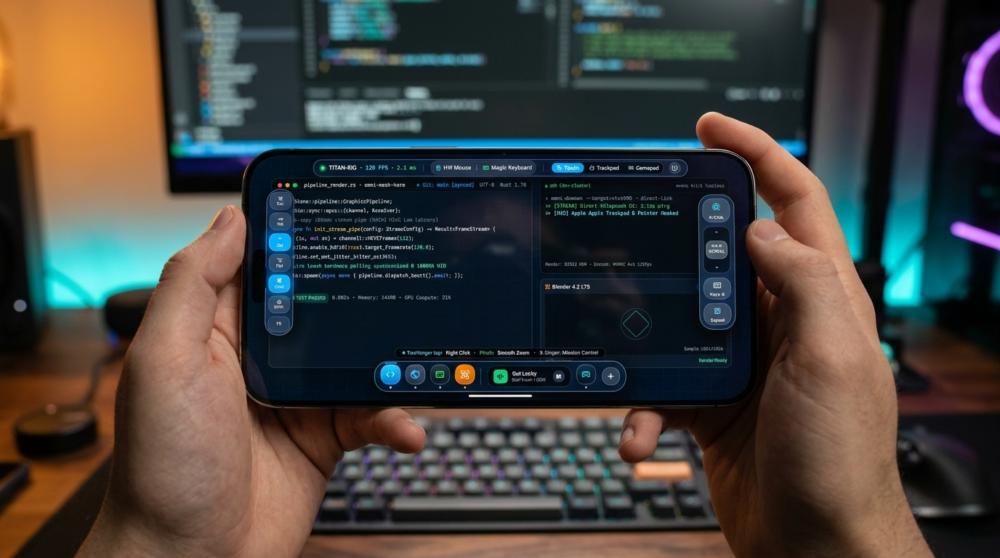
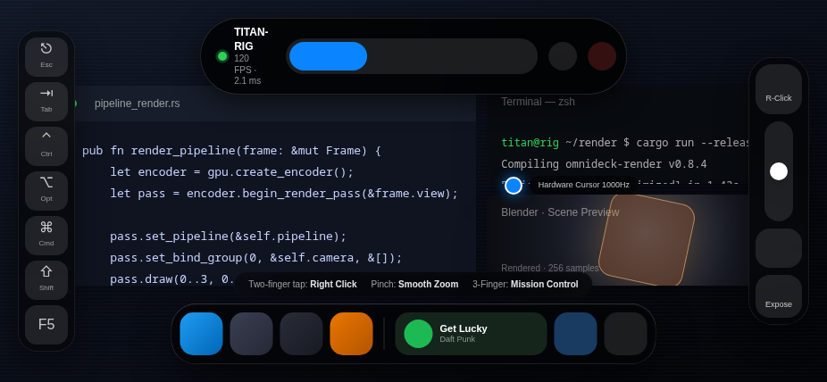
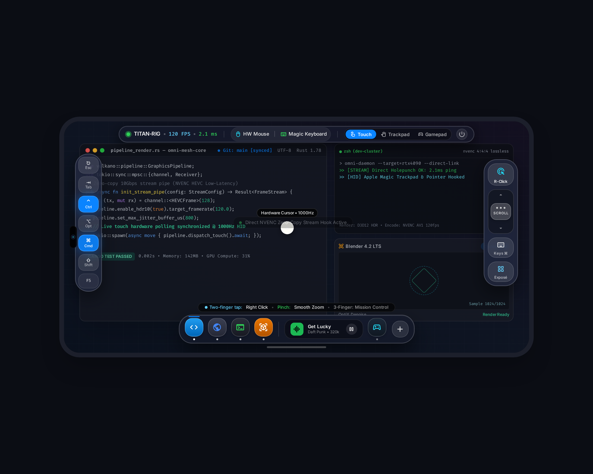
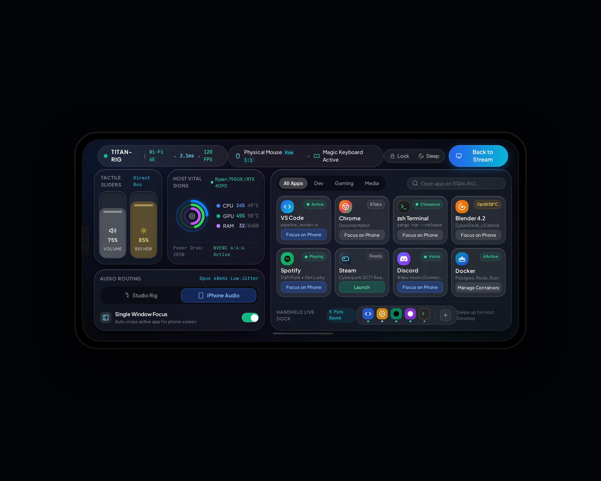

# OmniDeck

[](https://github.com/gust330/OmniDeck)
[](https://github.com/gust330/OmniDeck)
[](https://www.typescriptlang.org/)
[](https://capacitorjs.com/)
[](LICENSE)

**OmniDeck** is an iPadOS 18 Liquid Glass-inspired remote PC control system and cross-platform mobile companion app for iOS and Android. Engineered specifically for smartphones held in **landscape orientation** (20:9 / 19.5:9), it turns handheld devices into high-performance remote workstation controllers with thumb-zone macros, real-time host telemetry, Stage Manager app navigation, and full hardware mouse/keyboard passthrough.

---

## Visual Previews

### 1. Cinematic Feature Preview (Generated via Google Flow)

> An 8-second cinematic product video rendered with **Veo 3.1 Fast** is available at [`assets/omnideck_promo.mp4`](assets/omnideck_promo.mp4).

### 2. Built Mobile Application in Landscape (926 × 428 Viewport)


### 3. iPadOS Liquid Glass Stream Workspace


### 4. iPadOS Control Center & Stage Manager App Library


---

## Why OmniDeck?

Traditional remote desktop solutions shrink a multi-monitor desktop onto a phone screen, resulting in unreadable code, inaccessible menus, and awkward mouse dragging. Game-streaming clients focus solely on full-screen games, lacking desktop keyboard modifiers and productivity tools.

| Capability | Standard RDP / VNC | Moonlight / Steam Link | OmniDeck |
| :--- | :--- | :--- | :--- |
| **Ergonomic Thumb Zones** | ❌ None (stretch across screen) | ❌ Gamepad buttons only | ✅ Dual-thumb arc: Left modifier ribbon, right action pod |
| **Desktop Shortcut Chording** | ❌ Requires full on-screen keyboard | ❌ Clumsy overlay menus | ✅ 3-state tactile keys (`Ctrl`, `Alt`, `Cmd`, `Shift`) with latch & lock |
| **Single-Window Focus** | ❌ Full desktop scaling only | ❌ Fullscreen window only | ✅ Stage Manager auto-crop for high mobile legibility |
| **External Mouse & Pointer Lock** | ⚠️ Partial OS cursor capture | ⚠️ Relative movement only | ✅ Raw HID `requestPointerLock` with scroll wheel & 1:1 delta |
| **Hardware Keyboard Suppression** | ❌ Mobile OS intercepts hotkeys | ❌ Limited desktop key capture | ✅ Global interception (`Tab`, `Esc`, `Alt+Tab`, `F1-F12`) |
| **Host Telemetry & Quick Toggles**| ❌ None | ⚠️ Basic latency/bitrate | ✅ Apple Activity rings for CPU/GPU/RAM, thermals, audio routing |

---

## Repository Structure

```
OmniDeck/
├── app/                              # Production mobile application
│   ├── src/
│   │   ├── components/
│   │   │   ├── stream/               # StreamWorkspace, DynamicIslandHUD, ModifierRibbon, ActionPod
│   │   │   ├── control-center/       # ControlCenter, tactile sliders, concentric activity rings
│   │   │   ├── app-library/          # Stage Manager 8-app grid with 1-tap window routing
│   │   │   ├── dock/                 # DockManager with workspace presets & peripheral auto-switch
│   │   │   └── settings/             # SettingsModal with signaling, bitrate & touch calibration
│   │   ├── engines/
│   │   │   ├── input-engine.ts       # Touch gestures, pointer lock, keyboard capture, gamepad loop
│   │   │   └── stream-engine.ts      # WebRTC connection, SDP signaling, RTCDataChannel, mock fallback
│   │   ├── stores/                   # Zustand stores: connection, input, telemetry
│   │   └── hooks/                    # useCapacitorInit (landscape lock, status bar suppression)
│   ├── ios/                          # Native Xcode project targeting iOS 15+
│   ├── android/                      # Native Android project with Gradle wrapper
│   └── capacitor.config.ts           # Capacitor configuration with landscape orientation lock
├── DESIGN_SYSTEM.md                  # Complete design system specification (Apple HIG liquid glass)
├── index.html                        # Interactive smartphone landscape frame showcase
└── LICENSE                           # MIT License
```

---

## Architecture & Core Engines

### 1. Stream Workspace & Dual-Thumb Architecture
- **Dynamic Island HUD**: Centered 36px floating capsule showing host identity, 120 FPS counter, 2.1 ms latency, and segmented `Touch` vs `Trackpad` switcher.
- **Left-Thumb Modifier Ribbon**: 7 tactile keys (`⎋ Esc`, `⇥ Tab`, `⌃ Ctrl`, `⌥ Opt`, `⌘ Cmd`, `⇧ Shift`, `F5`) supporting 3-state cycling:
  $$\text{inactive} \longrightarrow \text{latched (single chord)} \longrightarrow \text{locked (continuous)} \longrightarrow \text{inactive}$$
- **Right-Thumb Action Pod**: 44px+ hit targets for tactile Right-Click, continuous vertical haptic scroll slider, on-screen keyboard toggle, and Exposé window switcher.
- **Floating Squircle Dock**: Live app dock with running status indicators and Spotify mini-player.

### 2. Control Center & Host Telemetry
- **Vertical Tactile Sliders**: Fluid glass sliders for Master Volume (75%) and Rig Monitor Brightness (85%).
- **Concentric Activity Rings**: Real-time monitoring of CPU (Ryzen 9 7950X), GPU (RTX 4090), and RAM (DDR5) utilization, thermals, and wattage.
- **Audio Routing**: 1-tap switching between Studio Rig Speakers and low-latency iPhone Audio (Opus 48 kHz).

### 3. Stage Manager App Library
- **8-App High-Density Grid**: Pre-configured tiles for VS Code, Google Chrome, Terminal, Blender 4.2, Spotify, Steam, Discord, and Docker.
- **Focus on Phone**: Auto-crops the active remote window for phone screen readability.

### 4. Input & Passthrough Engine
- **Touch Gesture Translation**: Single tap (click), double tap (double-click), two-finger tap (right-click), and 1-finger drag.
- **Hardware Mouse Passthrough**: Full `requestPointerLock` integration with raw delta translation and scroll wheel capture.
- **Hardware Keyboard Passthrough**: Global listener intercepting `Ctrl+W`, `Ctrl+T`, `Alt+Tab`, `Alt+F4`, `Meta+Q`, `Tab`, `Esc`, and `F1–F12` with `preventDefault()` to prevent mobile OS interception.
- **Gamepad Polling**: Standard DualSense and Xbox wireless controller mapping via the Gamepad API.

---

## Quickstart

### Prerequisites
- Node.js 18+ (tested on Node v22)
- npm 9+

### Run Locally in Browser / Simulator

```bash
cd app
npm install
npm run dev
```

Visit `http://localhost:5173` to test the landscape mobile interface directly.

### Run Verification & Tests

```bash
cd app
# Run 62 unit and integration tests across 7 test suites
npm test

# Run TypeScript checks and production bundle
npm run build
```

---

## Mobile Builds (iOS & Android)

The application is locked to landscape mode (`LandscapeLeft` & `LandscapeRight`) with native status bar suppression.

### Android Setup
```bash
cd app
npm run build
npx cap sync android
npx cap open android
# Or compile debug APK via Gradle:
cd android && ./gradlew assembleDebug
```

### iOS Setup
```bash
cd app
npm run build
npx cap sync ios
npx cap open ios
# Build or archive in Xcode targeting iOS 15+
```

---

## License

MIT © [Gustavo](https://github.com/gust330)
